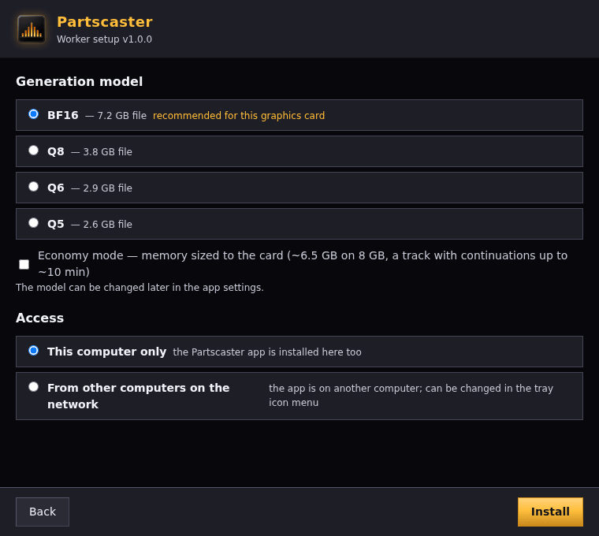

# Deployment
**English** · [Русский](../ru/deployment.md)

How to install Partscaster: the worker goes on a machine with an NVIDIA GPU, the app goes on a PC (often this is
the same machine), and, if you want, an AI agent connects through MCP. How the parts work: [architecture.md](architecture.md).

## Where to start

| Your case | Path |
|---|---|
| Linux with NVIDIA, ready-made build | [Release package](#release-package) → `install.sh` |
| Let an AI agent install it (Claude Code and others) | [Via an AI agent](#via-an-ai-agent) — MCP tool `install_worker` |
| Windows with NVIDIA, no WSL | [partscaster-worker.exe](#worker-on-windows-without-wsl--partscaster-workerexe) from the Windows package |
| Development, your own changes | [From source](#from-source) — `make worker`, `make build` |
| Windows, but you want a Linux worker | [WSL2](#worker-in-wsl2) |

After you install the worker: start the app, open "Settings", enter the worker address (a plain IP or machine
name is enough — port 8091 is added automatically) and press "Check". On the same machine, use `127.0.0.1`.

## Requirements

- **NVIDIA GPU with a driver** (`nvidia-smi` must work). Other GPUs are not supported:
  the installers check `nvidia-smi` and stop without it.
- **VRAM:** from 8 GB. Generation runs on yue2.cpp; the peak depends on the model: BF16 ~10 GB, Q8 ~8 GB,
  low-VRAM mode sizes memory to the card (~6.5 GB on an 8 GB card, a track with continuations up to ~10 min). More: [Generation model](#generation-model--yue2cpp).
- **Linux worker:** Linux with systemd (tested on Ubuntu), [`uv`](https://docs.astral.sh/uv/) —
  `install.sh` uses it to create the environment and install packages; it does not install `uv` itself. It looks for it
  in `PATH`, then in `~/.local/bin` and `~/.cargo/bin` (where the uv installer puts it; ssh without a login shell does not
  add them to `PATH`). uv downloads
  Python 3.12 by itself. Internet access — for packages and weights.
- **Disk:** worker base up to ~17.8 GB (environment ~7.4 + generation model up to ~7.7 + score and stem weights
  ~2.7) + sample kits ~1.2 GB + room for tracks.
  Optional components — in the [table below](#components-and-disk-space).
- **The YuE2 model is open:** weights (and the generation model in GGUF format) download from Hugging Face without a token or login.

## Release package

A release is the GitHub Release of tag `vX.Y.Z` (built by `.github/workflows/release.yml`). App packages in a
release have fixed names (the version is in the release title and in the folder inside the archive), so the link
`https://github.com/Zazza/partscaster/releases/latest/download/partscaster-windows-amd64.zip` always leads to the
latest version. It contains:

| File | What is inside |
|---|---|
| `partscaster-linux-<arch>.tar.gz` | app, `partscaster-mcp`, worker archive (with a ready-made yue2.cpp program for Linux, if built), `INSTALL.txt` |
| `partscaster-windows-amd64.zip` | the same for Windows + `partscaster-worker.exe` (with the worker and yue2.cpp for Windows inside); the worker archive next to it is for a Linux/WSL machine, without the Windows program |
| `partscaster-darwin-<arch>.tar.gz` | app `partscaster.app` (`partscaster-mcp` and the worker archive are inside `.app/Contents/MacOS/`); no yue2.cpp |
| `worker-<version>.tar.gz` | worker archive for a Linux machine with a GPU (the same as in the Linux package) |

**The yue2.cpp program for the packages** is built in advance by a separate workflow `.github/workflows/yue2cpp.yml`
(Windows — CUDA 12.8 and the runner's Visual Studio, Linux — a CUDA 12.8 container; about an hour). It runs by itself
when the build scripts or `worker/engine_cpp.py` change in develop/main and builds once per yue2.cpp commit
(`CPP_COMMIT`); the release downloads the ready build (the artifact lives 90 days) and builds it itself if there is none.

**A trial release from develop**: a tag with a hyphen (`v1.0.0-rc1`) on a develop commit builds all packages the
same way, but the release is marked as a pre-release and does not become the latest — `releases/latest` links do not
lead to it. The order:

1. Push develop and wait for a green "yue2.cpp" run in the Actions tab (the first one takes about an hour; after that
   it is skipped until the yue2.cpp commit changes).
2. Set the tag: `git tag v1.0.0-rc1 && git push origin v1.0.0-rc1` — "Release" starts for three OSes.
3. In the release check: there are `partscaster-windows-amd64.zip`, `partscaster-linux-amd64.tar.gz`,
   `partscaster-darwin-<arch>.tar.gz` and `worker-<version>.tar.gz`; the "Готовая сборка yue2.cpp" step log says
   "взята готовая сборка"; the Windows archive has `yue2cpp/yue-server.exe` inside `worker-*.tar.gz`.

Delete a failed trial together with its tag (`git push origin :v1.0.0-rc1` and the release on the Releases page),
the next one is `v1.0.0-rc2`.

The worker archives in packages for different OSes differ only in the yue2.cpp program. For a Linux machine with a GPU, take
`worker-<version>.tar.gz` or the archive from the Linux package: the archive next to the app in the Windows package has
no ready program (the Windows variant lives only inside `partscaster-worker.exe`, so the package is not twice as big),
and `install.sh` will start to build it from source (needs git, cmake, nvcc).

On the GPU machine:

```bash
tar xzf worker-<version>.tar.gz
./worker-<version>/install.sh
```

Then — the app ("Settings" → worker address → "Check") and, if you want, AI agents:
"Settings" → "For AI agents" (ready-made configs and the "Connect to Claude Code" button).

**Versions.** The worker answers `GET /version` (build, API version, code fingerprint, model, what is installed).
The app and MCP compare the API version: if the worker is older, a banner says "update the worker" (обновите воркер);
if it is newer — "update the app" (обновите приложение). Update **the worker first, then the app**.

**The site** `https://zazza.github.io/partscaster/` is the page `site/index.html` (ru/en) with "Download" buttons for
the latest release and the "before/after" examples from the welcome window. `tools/site-build.sh` builds it (the
clips and their list come from `internal/welcome/clips` and `frontend/src/welcomeClips.json`), and
`.github/workflows/pages.yml` publishes it when the page or the clips change in develop/main. Once in the repository
settings: Settings → Pages → Source: GitHub Actions; to publish from develop — Settings → Environments →
github-pages → allow the develop branch. To view locally: `tools/site-build.sh && python3 -m http.server -d _site`.

## Via an AI agent

The MCP tool `install_worker` installs the worker (together with stem separation) and optional components: empty `host` — on this PC,
`host=user@gpu-host` — on another machine over ssh. The archive is taken from next to `partscaster-mcp` (release package)
or built with `make worker-tar` (MCP built from source).

- By default it is a dry run: **nothing is executed**; it shows components, disk space and steps.
- To install: `dry_run=false`, `confirm=true` and an explicit choice of `whisper`, `seedvc` (true/false).
  Stem separation (RoFormer) is always installed; there is no separate choice.
- Paths: `hf_home` (weights cache, default `~/yue/hf-cache`), `sep_dir` (RoFormer environment and weights), `seedvc_dir`;
  generation model — `cpp_model=auto|bf16|q8|q6|q5` (without it — the one chosen earlier, if downloaded, otherwise the recommended one).
- Before installing, it checks the GPU and free space in the home directory; if there is not enough, the installation
  does not start.
- `doctor` — what is installed and working now (worker, components, GPU, disk space).

Inside, this is the same `install.sh` from the archive, plus steps for the components (see below) and starting the service.

## Components and disk space

| Component | Needed | Disk space | Without it |
|---|---|---|---|
| Worker: YuE2 generation on yue2.cpp, SheetSage2 score | required | up to ~17.8 GB (environment ~7.4 + generation model 3.1–7.7 during installation + score weights ~2.7 on first use) | — |
| Sample kits (drums, basses, orchestra) | installed together with the worker | ~1.2 GB | downloaded on first selection |
| Stem separation: BS-Roformer-SW + DrumSep (drums split into parts) | required | ~7.3 GB (environment 6.1 + weights 1.1) | — |
| whisper: what a finished track sings — a check for an AI agent (MCP `job_lyrics`) | optional | ~3.2 GB | `job_lyrics` returns an error; "Settings" shows "not found" |
| Seed-VC: "Album voice" (experiment) | optional | ~10–11 GB after installation, ~14 GB during it | the "Album voice" block with a "not installed" note |
| NAM: amplifiers in the sound engine | optional | a package folder without torch | only the `amp` block is unavailable |

Hugging Face weights (`HF_HOME`), RoFormer and Seed-VC can live on another disk — then you need less space on the
home disk.

## Linux worker: install.sh

The worker ships as a versioned archive. Its `install.sh` does both installation and update:

1. checks the GPU (`nvidia-smi`) before installing the new code (the move from the old name, if needed, runs
   even earlier — see below);
2. puts the code into `~/partscaster/releases/<time>-<version>/`;
3. creates the environment `~/yue/.venv` (`uv venv --python 3.12`) if it does not exist, and installs the packages from
   `requirements.txt` from the PyTorch cu128 index (torch is needed for score transcription, Seed-VC and NAM;
   generation itself runs in the yue2.cpp program) — only for a new environment or a changed `requirements.txt`
   (fingerprint — `~/partscaster/.requirements.sha256`, without comments and blank lines: editing the text does not
   reinstall packages);
4. creates `~/partscaster/worker.env` if it does not exist, with one line `HF_HOME=` (default
   `~/yue/hf-cache`, `--hf-home DIR` — another directory; the tilde is expanded — systemd does not understand it);
   with `--sep-dir DIR` it adds `PARTSCASTER_SEP_PY=DIR/venv/bin/python` and `PARTSCASTER_SEP_MODELS=DIR/models` there,
   if these lines are not there yet;
5. installs stem separation (see [Stem separation](#stem-separation--bs-roformer-sw-and-drumsep)): the environment
   and the weights; if that fails, the installation stops with an error and the previous version stays active;
6. installs the yue2.cpp program and the generation model (see [Generation model](#generation-model--yue2cpp)); if that
   fails, the installation stops with an error and the previous version stays active;
7. atomically switches the link `~/partscaster/current` to the new version and installs the unit
   `~/.config/systemd/user/partscaster-worker.service`;
8. installs sample kits (`kits_install.py`; if it fails, the next run or the app downloads them);
9. keeps 3 previous versions and deletes the rest;
10. restarts the service and waits up to ~30 s for an answer from `/health` (`--no-start` — without starting).

The generation model starts not when the worker starts, but on the first generation. Score weights download
on first use, stem separation weights — during installation.

| Parameter | What it does |
|---|---|
| `--no-start` | install without starting the service |
| `--hf-home DIR` | weights cache directory for a new `worker.env` |
| `--sep-dir DIR` | stem separation directory: environment `DIR/venv`, weights `DIR/models` (written to `worker.env` if the paths are not there yet) |
| `--cpp-model auto\|bf16\|q8\|q6\|q5` | generation model; `auto` — recommended by VRAM. Without the parameter — the one chosen earlier, if downloaded, otherwise the recommended one |
| `--cpp-low-vram` | turn on low-VRAM mode (without the parameter — as recommended for the card) |
| `--rollback` | `~/partscaster/current/install.sh --rollback` — go back to the previous version |

Paths are changed with installer variables: `PARTSCASTER_HOME` (default `~/partscaster`) and
`PARTSCASTER_VENV` (`~/yue/.venv`). Data (`~/partscaster/data`) and `worker.env` are shared by all versions,
and the installer does not touch them. The environment `~/yue/.venv` and the cache `~/yue/hf-cache` have these names for historical reasons.

**Autostart after reboot.** The service is a user service (`systemctl --user`) and starts together with the user
session. To make the worker start after a reboot without a login (usually needed on a separate
GPU machine), enable this once:

```bash
sudo loginctl enable-linger $USER
```

Control: `systemctl --user status|restart|stop partscaster-worker`, log —
`journalctl --user -u partscaster-worker -n 50`.

**Without systemd:**

```bash
cd ~/partscaster/current && ~/yue/.venv/bin/python -m uvicorn yue_worker:app --host 0.0.0.0 --port 8091
```

In this case, set the variables from `worker.env` and `PYTORCH_CUDA_ALLOC_CONF=expandable_segments:True` yourself.

**Migration from the old name.** If the home directory has `~/yue-studio` but no `~/partscaster` yet
(and `PARTSCASTER_HOME` is not set), `install.sh` moves the contents to `~/partscaster` by itself, disables and
removes the old `yue-worker` unit, renames the `YUE_*` keys in `worker.env` to `PARTSCASTER_*` and
leaves a link `~/yue-studio` → `partscaster`. The environment `~/yue/.venv` and the cache `~/yue/hf-cache` stay
in place. The app also copies its settings from the old folder once in the same way.

**ffmpeg** on the GPU machine is needed by the worker only for the spectrogram in the studio (`sudo apt install ffmpeg`);
without it the "spectrum" mode answers 503; the loudness waveform works. Stem separation needs ffmpeg too, but without
a system one it uses its own from the `imageio-ffmpeg` package.

### Updating

Order: **the worker first, then the app**. A new app with an old worker works, but without
the new features.

- From a release — `install.sh` of the new archive (as for installation).
- From source — `make worker` (or `./deploy.sh worker`) with `PARTSCASTER_DEPLOY_HOST=user@gpu-host`:
  the archive is copied to `~/partscaster/incoming` and installed by its `install.sh`.
- Restarting the worker interrupts running app and MCP operations (sound preset, rebuild — "interrupted")
  and removes the queue pause. A generation that was running at the moment of the restart is marked as an error; waiting generations
  stay in the queue.

### Worker variables

Set them in `~/partscaster/worker.env` (example — `worker.env.example` in the repository root); after editing —
`systemctl --user restart partscaster-worker`.

| Variable | Default | Meaning |
|---|---|---|
| `PARTSCASTER_DATA_DIR` | `~/partscaster/data` (the unit sets `<PARTSCASTER_HOME>/data`) | SQLite database, tracks, worker settings, kits, yue2.cpp models |
| `PARTSCASTER_HOME` | `~/partscaster` (set by the unit) | installation directory; the worker looks there for the yue2.cpp program built by `install.sh` (`yue2cpp-src`) |
| `HF_HOME` | `~/yue/hf-cache` (`install.sh` writes it into a new `worker.env`); without the line — `~/.cache/huggingface` | Hugging Face weights cache (SheetSage2 and MERT); generation models live in `PARTSCASTER_CPP_MODELS` |
| `PYTORCH_CUDA_ALLOC_CONF` | `expandable_segments:True` (set by the unit) | PyTorch VRAM allocation mode (score transcription and other worker operations) |
| `YUE2_MAX_TOKENS` | — | upper limit of the semantic token budget per song with continuations; unset — the model context minus room for style, lyrics and plan (21784 ≈ 14.5 min) |
| `YUE2_CFG_SCALE` | `1.5` | how closely to follow the style (classifier-free guidance): higher — more exact, but drier |
| `PARTSCASTER_WHISPER_PY` | `~/whisper-venv/bin/python` | interpreter of the whisper environment |
| `PARTSCASTER_SEP_PY` | `~/sep-venv/bin/python` | interpreter of the stem separation (RoFormer) environment |
| `PARTSCASTER_SEP_MODELS` | `~/sep-models` | RoFormer and DrumSep weights (~1.1 GB, downloaded during installation) |
| `PARTSCASTER_SEEDVC_DIR` | `~/partscaster/seedvc` | Seed-VC directory |
| `PARTSCASTER_NAM_DEPS` | — | folder with NAM packages for the `amp` block |
| `PARTSCASTER_FX_ENGINE` | — | `0` — sound engine turned off (`/jobs/{id}/fx` → 503), whatever the settings say |
| `PARTSCASTER_CPP_BIN` | — | your own `yue-server` program (otherwise — from the archive, then the one built by `install.sh`) |
| `PARTSCASTER_CPP_MODELS` | `<PARTSCASTER_DATA_DIR>/yue2cpp-models` | yue2.cpp model directory (GGUF) |

Variables of other programs:

| Variable | Where | Meaning |
|---|---|---|
| `PARTSCASTER_URL` | app, `partscaster-mcp` | worker address (takes priority over the one saved in "Settings"; default `http://localhost:8091`). An app started from a desktop shortcut does not see shell variables — set the address in "Settings" |
| `PARTSCASTER_MCP_DIR` | `partscaster-mcp` | where to download files (default `~/partscaster-mcp-downloads`) |
| `PARTSCASTER_HOME`, `PARTSCASTER_VENV` | `install.sh` | installation directory and worker environment |
| `PARTSCASTER_DEPLOY_HOST` | `deploy.sh`, `make worker` | `user@gpu-host` for deployment |
| `PARTSCASTER_TORCH_INDEX` | `seedvc_install.sh` | PyTorch index for Seed-VC (default CUDA 12.8) |

## Stem separation — BS-Roformer-SW and DrumSep

A required part of the worker: `install.sh` (and `install_worker`) installs it together with the worker. The stems
are made by BS-Roformer-SW (python-audio-separator): vocals, drums, bass, "other", and inside "other" — guitar and keys;
DrumSep also splits the drums into kick, snare, toms, hi-hat, ride, crash. About a minute and a half for a
4-minute track. There is no model choice.

It runs in a **separate environment** (audio-separator has its own torch and onnxruntime); the worker starts it as a
subprocess (`sep_run.py`). What `install.sh` does:

- environment — `PARTSCASTER_SEP_PY` from `worker.env`, without the line — `~/sep-venv`; packages are pinned:
  `audio-separator[gpu]==0.47.0`, `audioread`, `imageio-ffmpeg==0.6.0` (separation needs the ffmpeg program: without
  a system one it is taken from this package). A repeated installation with the same package set does not reinstall
  the environment (fingerprint — `~/partscaster/.sep-packages.sha256`); an environment that is already there is not touched;
- weights of both models (~1.1 GB) — right during installation, into `PARTSCASTER_SEP_MODELS`, without the line —
  `~/sep-models` (`sep_run.py download <directory>`, no GPU needed);
- if the environment or the weights fail, the installation stops with an error and the previous version stays
  active; a repeated run resumes the download.

The same by hand:

```bash
uv venv ~/sep-venv --python 3.12
uv pip install --python ~/sep-venv/bin/python "audio-separator[gpu]==0.47.0" audioread imageio-ffmpeg==0.6.0
~/sep-venv/bin/python ~/partscaster/current/sep_run.py download ~/sep-models
```

- In another location (for example, on another disk) — `install.sh --sep-dir /data/sep` or the agent
  `install_worker sep_dir=/data/sep`: the environment goes into `<sep_dir>/venv`, the weights into `<sep_dir>/models`,
  and the paths are added to `worker.env`. You can also write `PARTSCASTER_SEP_PY` and `PARTSCASTER_SEP_MODELS` yourself.
- If there is no environment or separation crashed, no stems are made and the worker returns the error
  «разделение на дорожки не удалось: …» ("stem separation failed: …"); the app's "Settings" shows "not installed".
  The fix is to reinstall the worker.
- **Weights license:** BS-Roformer-SW and DrumSep — CC BY-NC-SA (non-commercial).

## Optional components

They are installed separately — by an agent (`install_worker`) or by hand with the commands below. The worker works without them.

### whisper — track lyrics

Needed only by an AI agent: MCP `job_lyrics` recognizes what a finished track sings, so the agent can check
whether the given lyrics were sung. The app does not use whisper.

```bash
uv venv ~/whisper-venv && uv pip install --python ~/whisper-venv/bin/python faster-whisper
```

Path to the interpreter — `PARTSCASTER_WHISPER_PY`.

### "Album voice" — Seed-VC (experiment)

Replaces the voice timbre of a track with the timbre of a sample (`POST /jobs/{id}/voice`, MCP `voice_convert`); the music and
the melody do not change. The voice is recognizable, but it wobbles — this is a property of Seed-VC; inside phrases you can hear bits of music
that got into the vocal stem. It is installed into its own directory with its own environment; the worker calls it as a separate
program:

```bash
~/partscaster/current/seedvc_install.sh                 # into ~/partscaster/seedvc
~/partscaster/current/seedvc_install.sh /data/seedvc    # or into your own directory
```

- Needed: `git`, `uv`, ~14 GB during installation, ~10–11 GB after it (environment ~7.5 + weights ~2.4). The script
  checks disk space in advance. Everything — code of the pinned version, environment, weights, caches — is inside one directory.
- Non-default directory — `PARTSCASTER_SEEDVC_DIR=<directory>` in `worker.env` and a worker restart.
  Check: MCP `doctor` or `GET /config` (`seedvc_available`).
- Another CUDA version — `PARTSCASTER_TORCH_INDEX=<index>` before running the script.
- Resources (RTX 4070 Ti SUPER 16 GB): +3.8 GB VRAM during the conversion; 50 steps — ~0.6 of the vocal duration.
- Seed-VC license — GPL-3.0: the user installs it explicitly, and it runs as a separate program.

**ffmpeg on the app machine** is needed by player seeking and studio effects (they run locally).
On Windows the app checks for it at startup and, if missing, offers to download a pinned build
(GPL, ~82 MB — LGPL builds lack the rubberband filter the studio needs) into its data folder — `%AppData%\partscaster\tools\ffmpeg\bin`;
nothing is changed system-wide. Lookup order: the `PARTSCASTER_FFMPEG` variable (app and MCP) → PATH →
on macOS the Homebrew folders (`/opt/homebrew/bin`, `/usr/local/bin`: an app started from Finder does not see them
in PATH) → the app's own folder. On Linux/macOS the app warns at startup when ffmpeg is missing and shows the
install command (`apt`/`dnf`/`pacman`, `brew install ffmpeg`); no restart is needed after installing. A monthly BtbN
build is pinned (kept ~2 years, daily ones ~2 weeks); the `ffmpeg-url.yml` workflow checks the link weekly.

### NAM amplifiers

The sound engine (`POST /jobs/{id}/fx`, MCP `fx_apply`) runs on numpy/scipy and needs nothing. Only
the `amp` block needs neural-amp-modeler **0.12.2** (MIT; reads `.nam` v0.5 captures). It is installed into a separate
folder without its own torch (torch comes from the worker):

```bash
uv pip install --python ~/yue/.venv/bin/python --target /data/nam-deps --no-deps \
  neural-amp-modeler==0.12.2 wavio pytorch_lightning lightning_utilities torchmetrics auraloss \
  matplotlib contourpy cycler fonttools kiwisolver pillow pyparsing python-dateutil
```

Then `PARTSCASTER_NAM_DEPS=/data/nam-deps` in `worker.env` and a worker restart.

- Captures (`.nam`) and impulse responses (`.wav`) are not included — the user uploads them
  (`fx_asset_upload`) to `<data>/fx/amps` and `fx/irs`. The capture latency is measured on the first use.
- Rollback: `PARTSCASTER_FX_ENGINE=0` or `config_set fx_engine=false` — the endpoint answers 503; the app's ffmpeg
  effects work.

### Sample kits

Kits for the engine blocks (drums, bass, guitars, orchestra, piano) are installed in advance: `install.sh`
runs `kits_install.py` (~1.2 GB the first time, then no network needed). If a kit is missing, the app downloads it
on first selection with progress (`GET /fx/kits/progress`); by hand — MCP `fx_kit_install` or:

```bash
cd ~/partscaster/current && ~/yue/.venv/bin/python kits_install.py vsco-violin osdk
```

Run it with the variables from `worker.env` (`install.sh` does this), otherwise the kits go to the default data
directory. Files download through direct links from raw.githubusercontent.com (the lists are pinned in
`worker/fx_kit_files.json`); each file has 3 attempts, and an interrupted download resumes. Drum machines (`tr808`, `tr909`,
`linn`, `cr78`, `simmons`) and `synthbass` are synthesized by the worker itself, without network. Kit contents and licenses —
in [effects.md](effects.md).

## Generation model — yue2.cpp

Songs are generated by [yue2.cpp](https://github.com/ServeurpersoCom/yue2.cpp) — the YuE2-3B model in GGUF format.
The former PyTorch engine is gone. The model comes in four sizes:

| Model | File | VRAM at peak (song 2:47) |
|---|---|---|
| BF16 — uncompressed | 7.2 GB | ~10 GB |
| Q8 — almost lossless | 3.8 GB | ~8 GB |
| Q6 | 2.9 GB | ~7.7 GB |
| Q5 | 2.6 GB | ~7.7 GB |

A VAE (0.5 GB) is downloaded with every model. **Low-VRAM mode** (a smaller model context) sizes the context to the
card's VRAM: with Q8 on an 8 GB card ~6.5 GB, a track with continuations up to ~10 min (at least ~4.5 GB and ~3.5 min). Q6 and Q5 save almost no VRAM but sound rougher, so they are not recommended,
but you can choose them.

- **Recommended model** — by the VRAM of the first card: from 11.5 GB ("12 GB" cards) — BF16; from 9.5 GB
  ("10 GB" cards) — Q8; less, or the amount is unknown — Q8 in low-VRAM mode. It is only a hint: any model
  can be chosen. The recommendation comes from one piece of worker code (`python engine_cpp.py recommend [MiB]`);
  both installers use it, and the app's "Settings" show it.
- **Installation:** `install.sh` without parameters installs the recommended model; `--cpp-model bf16|q8|q6|q5` —
  your own, `--cpp-low-vram` — low-VRAM mode. A repeated installation (update) does not touch the model you have
  already chosen and downloaded. If there is no model (for example, the worker used to run on PyTorch), the
  recommended one is installed.
- **Program:** a ready-made build from the worker archive (`worker-<version>/yue2cpp/`, CUDA 12.8; the CUDA libraries
  come from the worker environment, the CUDA development package is not needed). If it is missing or does not start, `install.sh`
  builds the pinned commit in `$PARTSCASTER_HOME/yue2cpp-src` (needs git, cmake, nvcc, ~10 min).
  The program and the model are required: if they are not installed, the installation fails and the previous version
  stays active; a repeated run resumes the model download.
- **Models** — in `<data>/yue2cpp-models` (`PARTSCASTER_CPP_MODELS`), downloaded with a checksum check:
  during installation, from the app ("Settings" → "Generation model" → "Download") or with MCP `engine_model_install`.
- **Changing the model** — the app's "Settings" or MCP `config_set cpp_model=… cpp_low_vram=…`; takes effect from the
  next generation. The same seed on another model gives a different performance; notes and continuations carry over.
- **Old tracks** (made by the former PyTorch engine) are continued and rebuilt on yue2.cpp from their notes;
  a repeat with the same seed will sound different.

## Worker on Windows without WSL — partscaster-worker.exe

The Windows package has `partscaster-worker.exe` next to the app — one program without a console: the first run opens
an installation window, after that it lives as a tray icon (by the clock). The worker runs until the program is closed
from the icon menu. There is no autostart at Windows sign-in. The setup window, the icon menu and messages follow
the Windows interface language (Russian if Windows is Russian, otherwise English); to set it explicitly use the
`PARTSCASTER_LANG=ru` or `en` environment variable.



- **Installation window** (first run):
  1. welcome and a GPU check (`nvidia-smi`; no NVIDIA — a clear message and exit);
  2. folder: default `%LOCALAPPDATA%\partscaster-worker`, «Browse…», free/needed space (~30 GB); the choice is remembered;
  3. generation model: `bf16`, `q8`, `q6`, `q5` with the file size, the one recommended for this card is marked (the
     thresholds are the same as in `install.sh`: the program reads them from `engine_cpp.py` of the embedded code, no
     Python needed); an «economy mode» checkbox;
  4. access: «this computer only» or «from other computers on the network» (the worker has no authentication — this PC
     only by default);
  5. installation: stages «Python and packages» → «Stem separation» → «Generation model» → «Start», a «what is
     happening» line and an expandable log; on failure — the error text and «Retry» (resumes);
  6. done: the address for the app and «Copy».

  You can close the window during installation: the program asks whether to abort; the next run resumes.
- **What goes into the folder:** uv (pinned version, sha256 check), Python 3.12, the `venv` environment with packages
  (`requirements.txt`, `torch`/`torchaudio` `2.10.0+cu128` — score transcription; the yue2.cpp program also takes the CUDA
  libraries from them; `truststore`), the stem separation environment `sep-venv` (torch with CUDA, cu128 index) with the
  RoFormer/DrumSep weights in `sep-models`, the generation model in `data\yue2cpp-models`. Worker code is in `app\`,
  tracks and settings — in `data\`.
- **Tray icon:** worker state («starting» / «running» / «stopped with an error»), the address for the app (click — to the
  clipboard), «Access from other computers on the network» (checkbox; the worker restarts with the new address), «Log»
  (opens `logs\worker.log` in Notepad; the previous run — `worker.1.log`), «Exit» (asks if a generation is running;
  the queue is kept and continues on the next start). Starting the program again while the worker runs shows «already
  running».
- **After that:** starts straight into the tray. Packages are reinstalled only if their set changed (fingerprints —
  `packages.sha256`, `sep-packages.sha256`); a new program version with new packages shows the window with installation
  progress, without questions.
- **Flags** (for a shortcut): `--home FOLDER`, `--lan`, `--cpp-model auto|bf16|q8|q6|q5`, `--cpp-low-vram` — a given flag
  fills its window step.
- **Certificates:** uv takes them from the Windows store (`UV_SYSTEM_CERTS`), Python — through `truststore`;
  downloads work even where an antivirus or proxy replaces HTTPS certificates.
- The yue2.cpp program (`yue2cpp\yue-server.exe`) is part of the package. To change the model later — in the app's
  "Settings".
- The program does not install optional components (whisper, Seed-VC); it does not install sample kits in advance —
  they download on first selection.

## Worker in WSL2

For Windows where you need a normal Linux worker (for example, dual-boot with a shared disk). CUDA in WSL2 works
through the NVIDIA driver installed in Windows:

```powershell
wsl --install -d Ubuntu
```

Inside WSL, install `uv` and the worker the same way as on Linux (`install.sh`). If the weights and data are on a Windows disk
shared with the Linux boot (in WSL it is visible as `/mnt/<drive letter>`), set them in `~/partscaster/worker.env`:

```bash
HF_HOME=/mnt/<drive>/hf-cache                       # do not download the weights again
PARTSCASTER_DATA_DIR=/mnt/<drive>/partscaster-data  # shared tracks (or keep your own)
```

In WSL without systemd, start it with the command from the "Without systemd" section.

The app on Windows connects to `http://localhost:8091` (or to the WSL IP — `wsl hostname -I`).
If the data is shared, do not run the workers of both boots at the same time — there is one SQLite database.

## From source

Requirements: Go 1.24+, Node.js 20+, [Wails CLI v2](https://wails.io) of the same version as in `go.mod`
(v2.12.0: `go install github.com/wailsapp/wails/v2/cmd/wails@v2.12.0`). For the worker — `uv`; for
`make lint` — `ruff` (golangci-lint optional); for `make yue2cpp` — docker.

| Command | What it does |
|---|---|
| `make worker` | worker archive to the GPU machine (`PARTSCASTER_DEPLOY_HOST=user@gpu-host`) and its `install.sh` |
| `make worker-tar` | only the archive `dist/worker-<version>.tar.gz` |
| `make yue2cpp` | ready-made yue2.cpp build for the worker archive (in a CUDA 12.8 container) |
| `make build` | app `build/bin/partscaster` with the version from git |
| `make mcp` | MCP server `build/bin/partscaster-mcp` (connecting — [mcp.md](mcp.md)) |
| `make mcp-data` | regenerate the MCP library data from the frontend |
| `make release` | package for this OS in `dist/` |
| `make dist-linux` / `dist-windows` / `dist-mac` | package for an OS |
| `make install-desktop` / `uninstall-desktop` | shortcut in the Linux applications menu |
| `make test`, `make lint`, `make fmt` | tests, linters, Go formatting |

### Packages by OS

| Target | Where it builds | Result |
|---|---|---|
| `make dist-linux` | Linux only | `partscaster-<version>-linux-<arch>.tar.gz` |
| `make dist-windows` | Linux or Windows | `partscaster-<version>-windows-amd64.zip` (with `partscaster-worker.exe`) |
| `make dist-mac` | Mac only | `partscaster-<version>-darwin-<arch>.tar.gz` |

Before the package, yue2.cpp is built if it is not in `dist/` yet: on Linux — if docker is available, on Windows —
if CUDA Toolkit (`nvcc`) is available. The Windows package is not built without a ready-made build:
`partscaster-worker.exe` cannot build the program itself. The Linux worker archive is built without it, with a
warning — `install.sh` builds the program on the GPU machine.
The release in CI starts from a `v*` tag, which a human sets and pushes; each OS package is built on its own
runner.

### App by OS

**Linux (main platform):**

```bash
sudo apt install libgtk-3-dev libwebkit2gtk-4.1-dev
make build              # build/bin/partscaster
make install-desktop    # shortcut in ~/.local/share/applications
```

The shortcut is also needed for the icon: GNOME on Wayland takes it only from a `.desktop` file. Sound — through `pw-play`
(PipeWire): the webview in webkit2gtk has no audio output.

**Windows:** `wails build` (WebView2) → `build\bin\partscaster.exe`; the whole package — `make dist-windows`.
Sound — through WPF MediaPlayer (PowerShell). Worker — `partscaster-worker.exe`, WSL2 or a separate machine:
the app needs only HTTP access to it.

**macOS:** the package builds (`make dist-mac`, WKWebView), but it was not tested. The app player on macOS is
the system `afplay` (volume applies from the next start), "open folder" uses `open`; not tested on a Mac. The worker needs NVIDIA, so you cannot install it on a Mac — only use the address of a worker on another machine.
